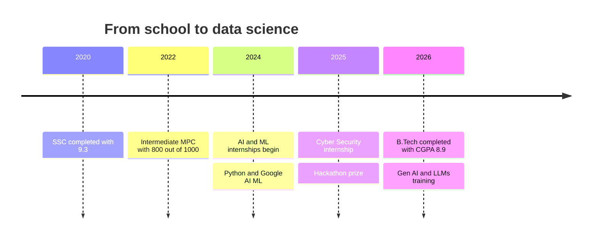

# Pandikunta Balaji

### Data Scientist · AI & ML

 

  

- 🎓 **B.Tech graduate** in AI & Machine Learning, **CGPA 8.9**
- 🧠 Currently training in **Data Science with Gen AI & LLMs** at Innomatics Research Labs
- 🔭 Building **machine learning projects** in classification, regression and fraud detection
- 🌱 Always learning the tools and techniques the field is moving toward
- 🎯 Looking for a **Data Science / AI-ML role** where I can grow and contribute

> *"I like turning raw data into insights people can act on, and building things that work."*

  

| | Project | What it does |
| :-: | --- | --- |
| 💳 | **Online Payment Fraud Detection** | Trains and compares ML algorithms to spot fraudulent online payment transactions |
| 💰 | **Income Classification** | Uses logistic regression to classify which income bracket a person falls into |
| 💎 | **Diamond Price Prediction** | Regression model that predicts a diamond's price from its attributes |
| 📧 | **Email Spam / Ham Detection** | Classifier that separates spam emails from genuine ones |
| 🐦 | **Flappy Bird AI Game** | Flappy Bird clone with an AI that learns to play the game on its own |
| 🌐 | **Portfolio Website** | Responsive personal site with animations: [dulcet-cuchufli-98a905.netlify.app](https://dulcet-cuchufli-98a905.netlify.app) |

| Role | Organization | Period |
| --- | --- | --- |
| **Data Science with Gen AI & LLMs** | Innomatics Research Labs | 05/2026 – Ongoing 🟢 |
| **Cyber Security** | AICTE-Eduskills (Palo Alto) | 01/2025 – 03/2025 |
| **Web Full Stack Developer** | AICTE-Eduskills Foundation | 10/2024 – 12/2024 |
| **Google AI-ML Virtual Internship** | AICTE-Eduskills Foundation | 07/2024 – 09/2024 |
| **Python with Data Structures & Algorithms** | YBI Foundation | 05/2024 – 06/2024 |
| **Artificial Intelligence & Machine Learning** | YBI Foundation | 03/2024 – 05/2024 |

| Degree | Institution | Year | Result |
| --- | --- | --- | --- |
| B.Tech, AI & Machine Learning | DVR & Dr. HS MIC College of Technology | 2026 | CGPA 8.9 |
| Intermediate (M.P.C) | M.N.M Jr. College | 2022 | 800 / 1000 |
| SSC | K.V.N & L High School | 2020 | 9.3 |

<b>📜 Certificates (click to expand)</b>

 

- Python Programming (Basic), **HackerRank**
- Python Programming for Data Science, **NPTEL**
- CodingChallenge21, **Naukri Campus**
- Introduction to Blockchain, **VOIS**
- Soft Skills, **TCS ION**
- Fundamentals of AI & ML, **YBI Foundation**
- Data Science with Gen AI & LLMs, **Innomatics Research Labs**

<b>🏆 Achievements and Hobbies (click to expand)</b>

 

- Consolation prize, institute-level hackathon (2025)
- Led the team to the school-level cricket championship (2020)
- Hobbies: learning new technologies, puzzle games, cricket, horror movies

📧 **balajipandikunta93@gmail.com** &nbsp;|&nbsp; 📱 **+91 9392464958** &nbsp;|&nbsp; 🌐 **[dulcet-cuchufli-98a905.netlify.app](https://dulcet-cuchufli-98a905.netlify.app)**

